# JalSetu — Submission

KeralAI Grand Challenge 2026 (Kochi) · Team Vortex · Problem 07 (Backwater Cargo Exchange)
*Written 7 Oct 2026. Describes only what runs in this repository; status labels are defined in §5.*

## 1. In one paragraph

JalSetu is a prototype that helps a cargo owner in Kerala decide how to move a shipment: by road, by water (hybrid,
meaning a barge leg between jetties), or by road alone when road is better. It compares the options on cost, time,
CO₂ and reliability, recommends one with a plain-English reason, matches the shipment to vessel sailings, and keeps a
person in charge of every booking, every re-plan after a disruption, and every hazardous-cargo booking. It also lets
boat owners register vessels and sailings and lets warehouse owners register storage. The decision logic is
deterministic Python; a language model is never used to price, rank or recommend, and the demo does not call one at all.

## 2. Judging criteria map

| Criterion (weight) | What we offer | Where to see it |
|---|---|---|
| Problem relevance (15%) | A cargo owner choosing between road and a barge leg on Kerala's backwaters has no single place that compares cost, time, CO₂ and reliability for their own deadline, checks vessel eligibility, and keeps them in control when something goes wrong | §3 |
| Impact / user value (15%) | Reference scenario computed by the engine; effort and error reduction described honestly, **not measured with real users** | §3 |
| Prototype functionality (25%) | The core journey runs end to end: compare → post cargo → match → book (two-step) → track → disruption → re-plan → deliver → reliability history | §6, §8, demo script in the [README](../README.md#five-minute-demo-script) |
| AI / technical innovation (20%) | A hard boundary between a deterministic, auditable decision engine and any language model; every number carries its evidence level; humans gate every state change | §4 |
| Feasibility / scalability (10%) | What it would take to become real: data, dependencies, cost, growth | §10 |
| Responsible AI / privacy / security (5%) | PII scrubbing, human review, uncertainty tags, fairness prior, no handling advice for hazardous goods, disclosed third parties | §11, §15 |
| Presentation / demo (10%) | Five-minute script, real screenshots, and the limitations we expect to be asked about | §8, §13, §14 |

## 3. Problem and user value

**Who and what they need.** Cargo owners (shippers) need the fastest or cheapest *reliable* way to move goods and a
clear reason for the recommendation. Boat owners need a way to be found and to build a track record. Warehouse owners
need a way to offer storage. Planners need to see which corridors and disruptions matter. The expected outcome is a
decision a person can understand, check and confirm.

**Reference scenario, computed live by the engine** (10 t, Kochi Thevara → Alappuzha, ready 04:00, subsidy off; all
figures `assumed`):

| Deadline | Recommended | Cost | Time | CO₂ |
|---|---|---|---|---|
| 10 h | hybrid | Rs 5,800 | 6.3 h | 9.7 kg |
| 3 h | road | Rs 6,470 | 1.6 h | 39.3 kg |

For the 10 h case, road would cost Rs 6,470 and emit 39.3 kg, so water saves about Rs 670 and 29.6 kg CO₂ **for the
barge leg only**. First- and last-mile trucking is not included in the hybrid figures, so this is not a door-to-door
saving. The 3 h case shows the system recommending road when road is the better answer.

**Practical benefit, stated honestly.**
- *Less effort:* one screen compares the options and explains the choice; a recommendation takes about 8 ms to
  compute (measured in-process).
- *Fewer errors:* hazardous cargo is never matched to an uncertified or unverified vessel, excluded vessels are shown
  with a reason, and every booking and re-plan needs an explicit confirmation.
- *Better accessibility:* badges, statuses and warnings carry text labels, not only colour (reviewed by eye; no formal
  accessibility audit).
- Time saved, cost saved and user satisfaction **have not been measured with real users**. All figures rest on the
  assumptions listed in [SPEC.md §5](SPEC.md#5-data-honesty-sourced-assumed-simulated).

## 4. What is original

- **Decision engine vs language model boundary.** `backend/engine/` is pure Python: no I/O, no clock, no generated ids,
  no LLM imports (checked by grep and by tests). A language model may only turn text into fields, and the demo uses none.
  Nothing a model says can change a price, ranking or compliance outcome.
- **Evidence levels on every number.** `[sourced]`, `[assumed]` and `[simulated]` badges sit next to figures, and a test
  keeps the documentation tables in step with the configuration.
- **Human in the loop by construction.** Booking, hazardous-cargo compliance review, re-plan and staging each need a
  separate explicit confirm. Proposals are read-only, and tests check they leave bookings unchanged.
- **Reliability that does not punish newcomers.** A Bayesian prior gives new vessels a starting score, and the number
  of recorded trips is always shown beside the percentage.
- **Shipment first, not boat first.** Road, hybrid and re-plan alternatives are compared on equal terms; road wins when
  it is better.

## 5. Status labels used throughout

| Label | Meaning |
|---|---|
| **BUILT AND TESTED** | Implemented; covered by automated tests that pass today |
| **BUILT, MOCKED** | Implemented and runs, but data, actor or integration is simulated and tagged `[simulated]` in the UI |
| **ROADMAP** | Not built, or code exists but has never been run |

## 6. What runs

| Feature | Status |
|---|---|
| Road vs hybrid comparison with reason; recommends road when road is better; subsidy what-if (off by default) | BUILT AND TESTED |
| Sailing matching with capacity ranking; excluded vessels listed with the reason | BUILT AND TESTED |
| Two-step booking: preview, then explicit confirmation | BUILT AND TESTED |
| Hazard classes with a hard filter (certification, permitted mode); excluded vessels never silently dropped | BUILT AND TESTED |
| Compliance-review gate for hazardous bookings and re-plans | BUILT, MOCKED (reviewer is a demo button) |
| Free-text intake with offline parser; low confidence asks a person to check | BUILT AND TESTED |
| Vessel registration (form or pasted English message), sailing publication, duplicate and field validation | BUILT AND TESTED |
| Vessel verification, suspension, reinstatement | BUILT, MOCKED (demo admin buttons, no identity check) |
| Bayesian reliability from delivery history, always shown with trip count | BUILT AND TESTED; history data is BUILT, MOCKED |
| Milestone timeline, disruption trigger, notification preview | BUILT, MOCKED (demo controls; nothing is sent; no live tracking) |
| Re-plan with ranked alternatives and an explicit confirm; nothing changes before it | BUILT AND TESTED |
| Warehouse registry, utilisation, staging plan attached to a booking | BUILT AND TESTED (warehouse data simulated) |
| Corridor viability and disruption summary for planners | BUILT AND TESTED (inputs simulated) |
| Live IBM watsonx.ai Granite parsing | ROADMAP (code present, never run) |
| Live vessel tracking, payments, authentication, real WhatsApp/SMS, vessel-registry check, Malayalam intake, database | ROADMAP |

Per-feature evidence (test file and screenshot for each row): [SPEC.md](SPEC.md).

## 7. Evidence

- **Tests:** `python -m pytest backend/ -q` → **261 passed** on 7 Oct 2026 (Python 3.14.5, pytest 9.1.1). Per-file counts in [SPEC.md §3](SPEC.md#3-test-evidence).
- **Offline:** the full suite also passes with all non-loopback socket connects and DNS lookups blocked.
- **Engine purity:** `grep` finds no LLM or adapter imports and no `uuid`, `random` or `datetime` in `backend/engine/`.
- **Demo script run in a real browser:** post cargo → match → book → confirm → disrupt → alternatives → confirm re-plan → reset, driven in headless Chrome; every step succeeded.
- **The UI has no automated tests.** Its evidence is the screenshots below, taken from the running app.

## 8. Screenshots (real, from the running app)

**Hero flow: the deadline slider flips the recommendation (10 t Kochi Thevara → Alappuzha)**

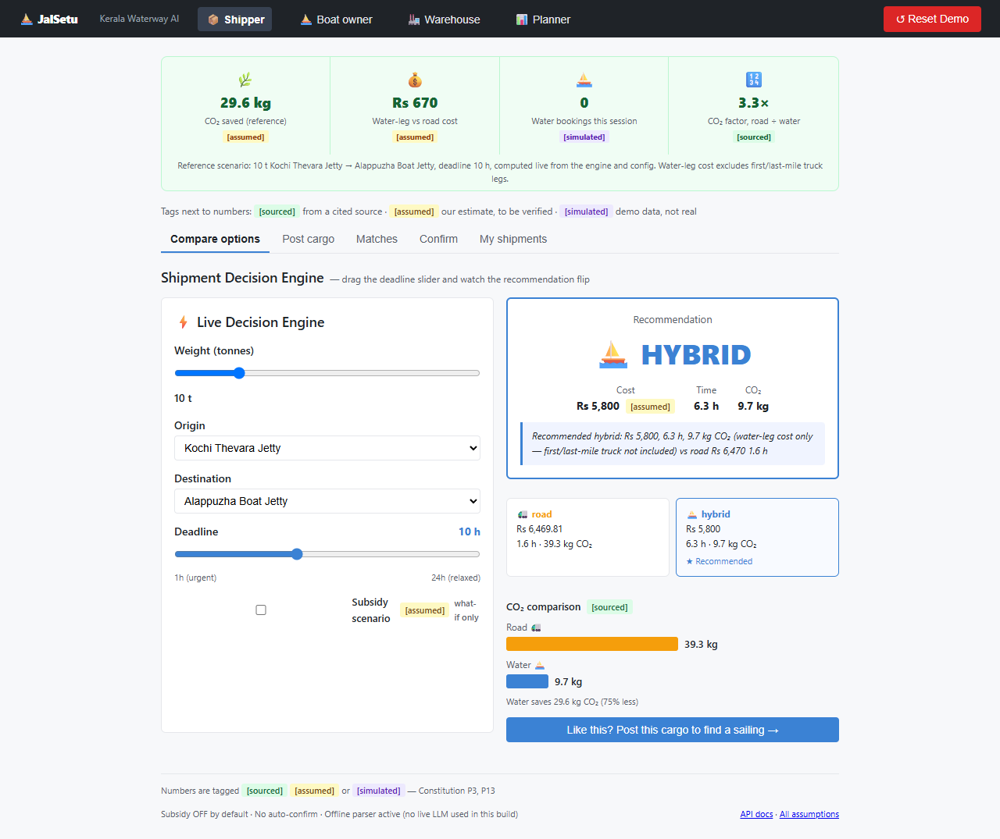
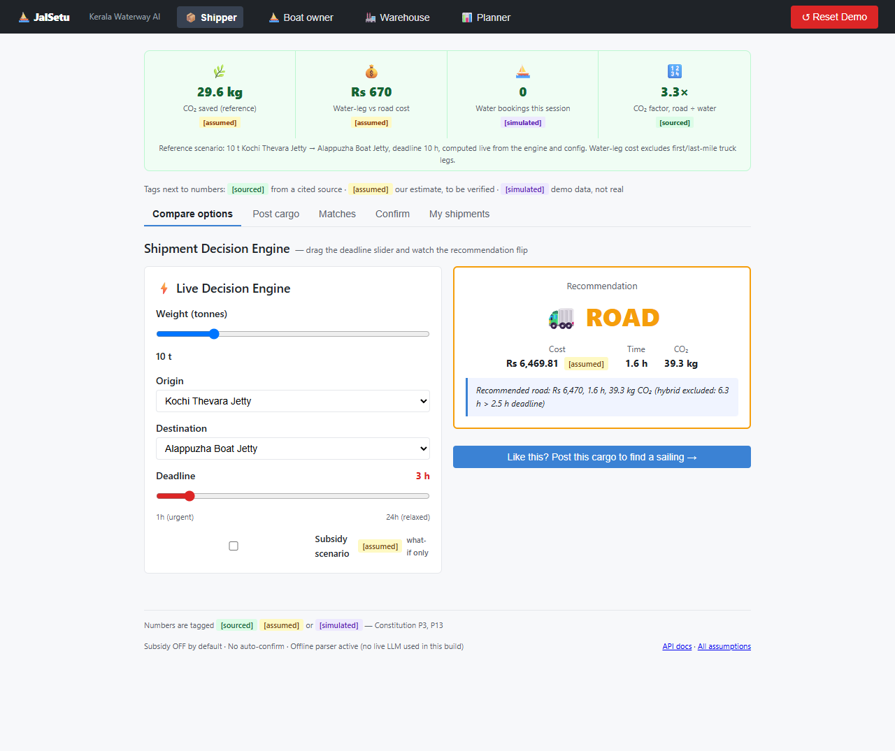

**Hazardous cargo: banner, then no certified vessel, with reasons**

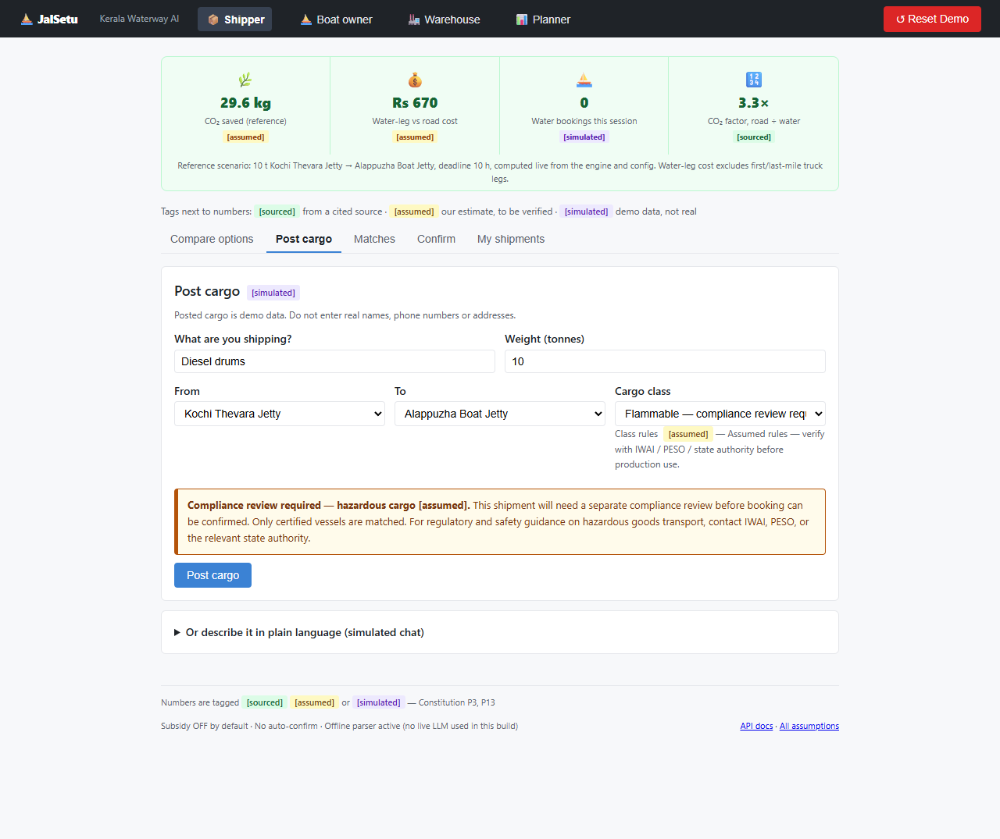
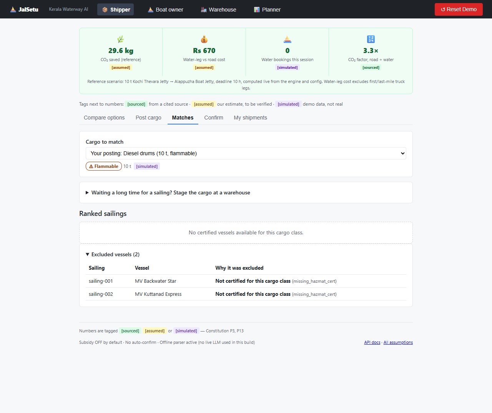

**Disruption: timeline, notification preview, ranked alternatives, explicit confirm**

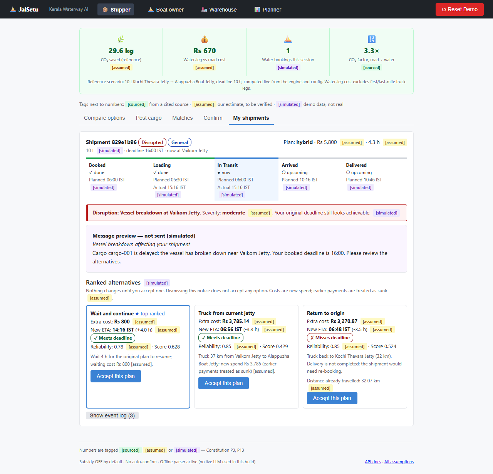
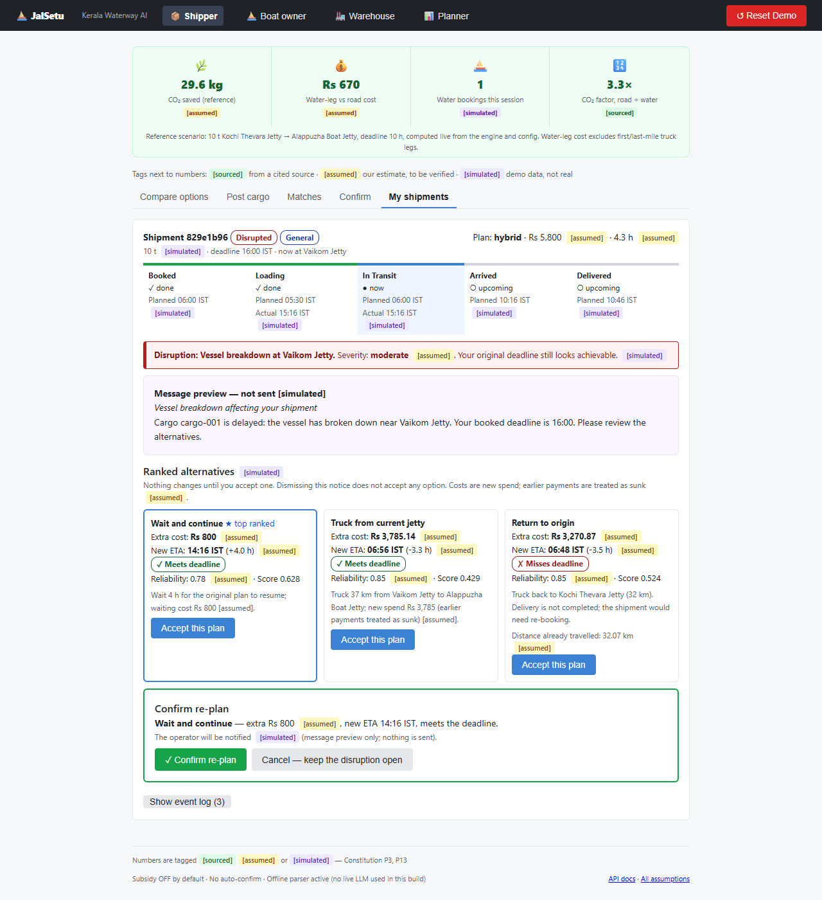

**Planner, boat owner, warehouse**

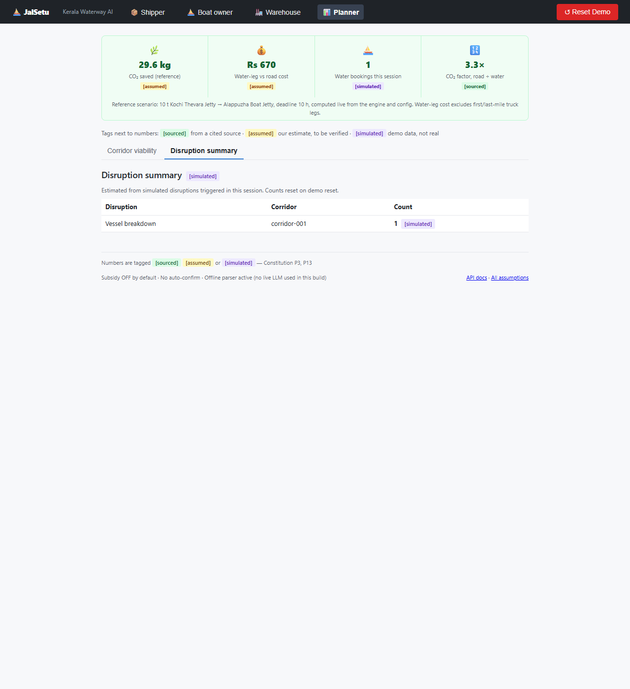
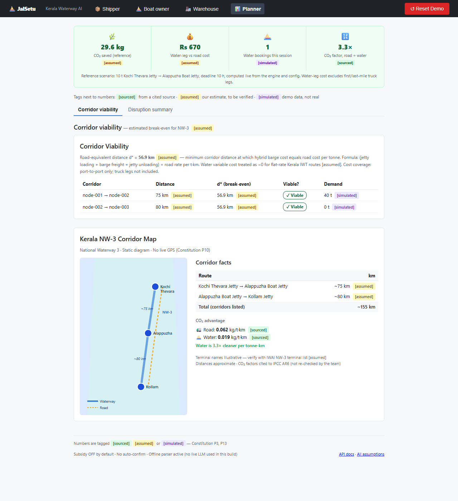
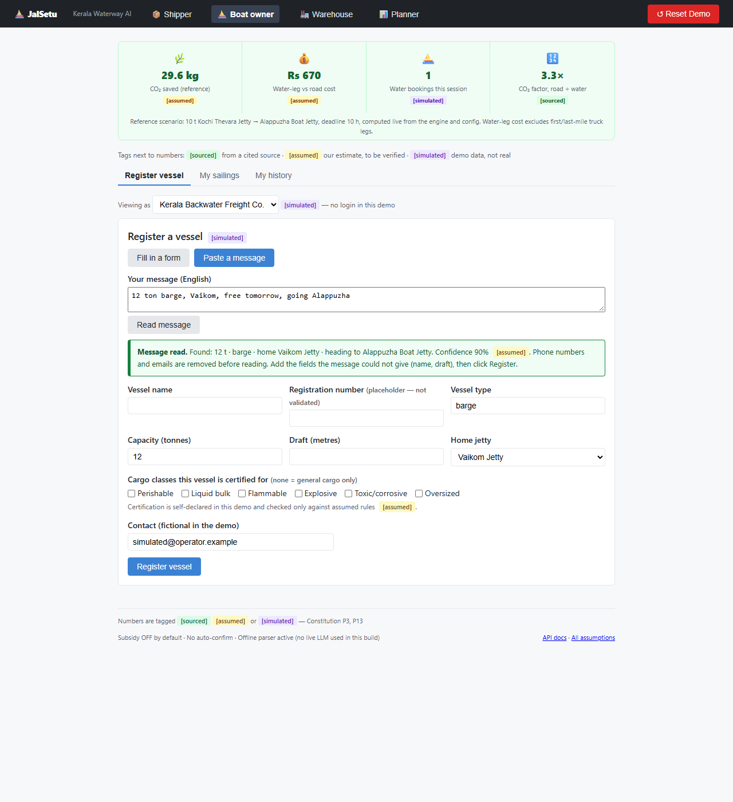
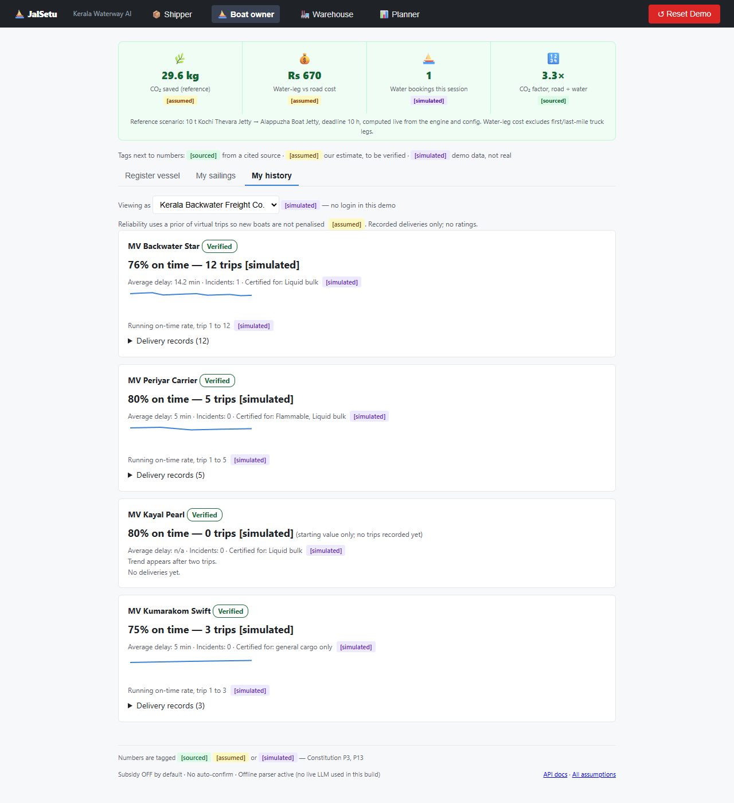
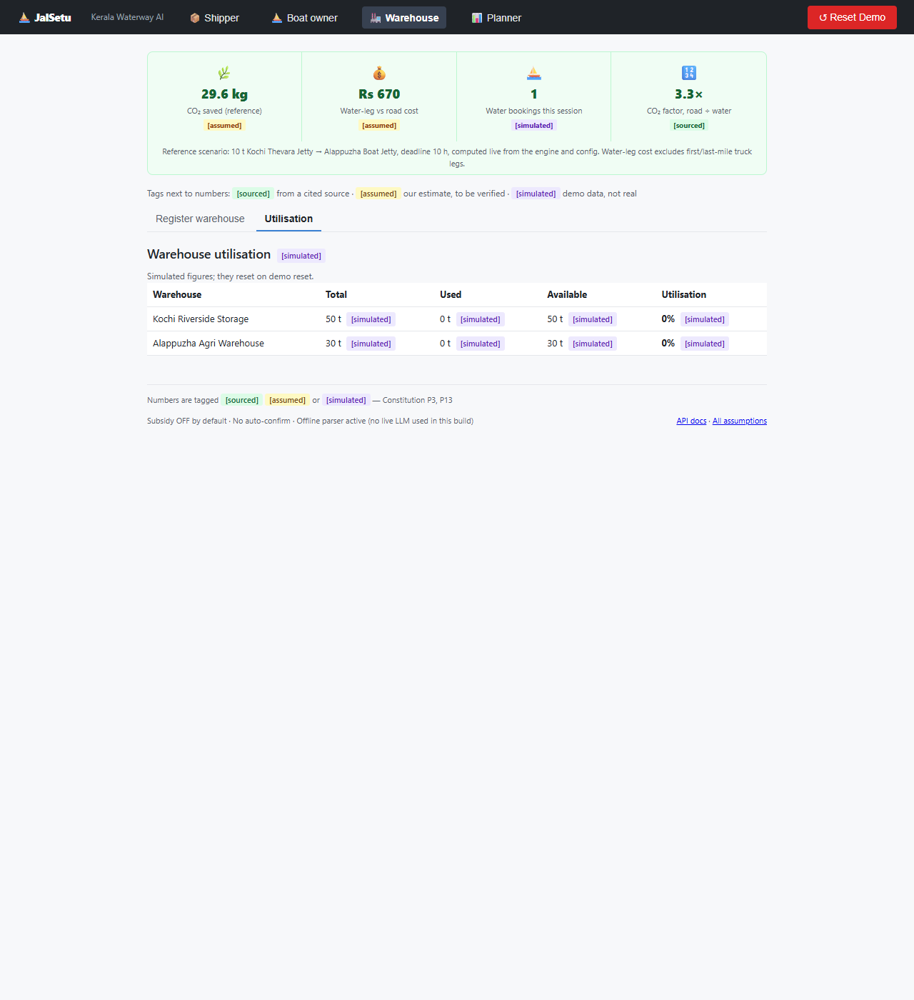
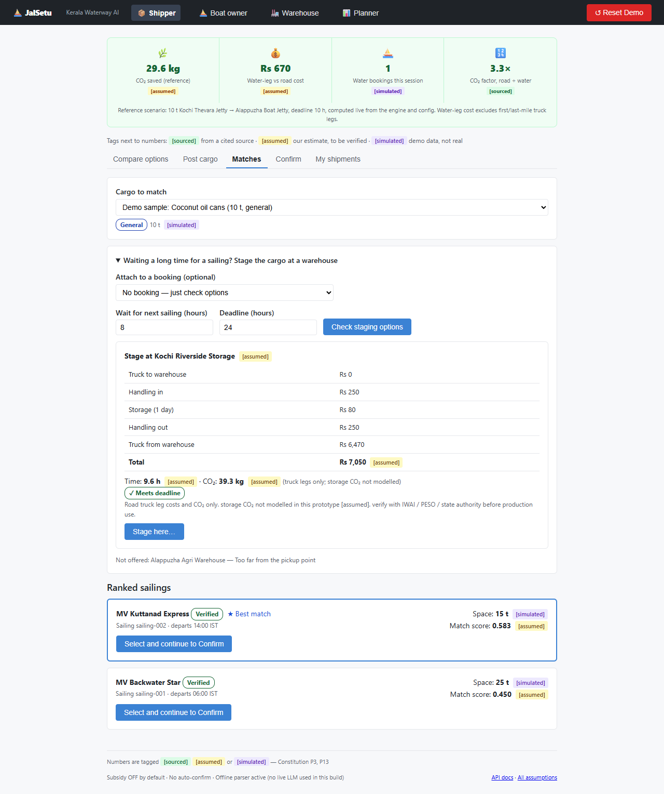

## 9. How to run it

Backend (repository root; Python tested on 3.14.5):

```
pip install -r backend/requirements.txt
JALSETU_MOCK_LLM=1 python -m uvicorn backend.api.main:app --port 8000
```
(PowerShell: `$env:JALSETU_MOCK_LLM="1"; python -m uvicorn backend.api.main:app --port 8000`)

Frontend (Node.js tested on 24.14.0):

```
cd frontend
npm install
npm run dev
```
Open http://localhost:5173. No API keys needed. Step-by-step demo script: [README.md](../README.md#five-minute-demo-script).

## 10. Feasibility and scalability (what becoming real would need)

| Need | Today | To become practical |
|---|---|---|
| Rates, speeds, handling costs | `assumed` placeholders | Tariffs and operating data from IWAI, operators and shippers |
| Jetty names, depths, distances | 4 illustrative nodes, straight-line distances | IWAI terminal and chart data; a routing API for road legs |
| Vessel identity and certification | Self-declared, one-click demo verification | Integration with the vessel registry and certificate holders |
| Hazard rules | Assumed placeholders | Verified rules from IWAI / PESO / state authorities |
| Live conditions | Simulated milestones and disruptions | Operator-reported or tracked positions, depth and weather feeds |
| State and users | In-memory, no authentication | Database, authentication and roles, audit log |

**Dependencies and cost:** only open-source libraries (listed in ATTRIBUTIONS.md); running the demo needs no paid
service or API key, and the language-model adapter is optional. **Growth:** the engine functions are stateless, so they
can run in more than one process; the in-memory store is the part that must be replaced first. None of the
production items above is built; they are ROADMAP.

## 11. Responsible AI, privacy and security

- **Privacy:** all people, vessels, contacts and history are fictional (`simulated`). Phone numbers and emails are
  removed before text reaches any parser or model adapter (`scrub_pii`, covered by tests). No real personal data is
  stored or sent anywhere.
- **Human review:** nothing is booked, re-planned, staged or approved for hazardous cargo without an explicit person
  click; parse confidence below 0.8 asks the user to correct fields first.
- **Errors and uncertainty:** every constant carries a note and a status; the two CO₂ factors are flagged as not yet
  re-checked; notifications are previews and are never sent.
- **Bias and fairness:** reliability uses a prior and shows its sample size. The one deliberate penalty (unverified
  vessels) is configurable and disclosed, and hazardous cargo is kept off unverified vessels by a named rule, not a score.
- **Safety:** for hazardous goods the system gives eligibility guidance only. It does not give handling or safety
  instructions and tells users to contact IWAI, PESO or the state authority.
- **Security (prototype level):** secrets belong in `.env` (git-ignored); `.env.example` holds dummy values only; a scan of
  the repository found no keys. The API has **no authentication**, and the CORS allow-list is `localhost:5173` only.
- **Third parties:** all tools, models and libraries are disclosed (§15).

## 12. Honest data

Every constant is in `data/config.yaml` with a note and a tag. Of 67 entries only four are `sourced`; the rest are
`assumed` and must be verified with the relevant authority (IWAI, PESO, state bodies, operators). The two sourced CO₂
factors cite IPCC AR6 WG3 Table 10.1 but **the team has not re-checked the numbers against the table**. Everything
about people, vessels, delivery history and warehouses is invented and tagged `simulated`. The table of every entry is
generated into [SPEC.md §5](SPEC.md#5-data-honesty-sourced-assumed-simulated), and a test fails if it goes out of date.

## 13. Limitations

- State is in memory in one process; no authentication, database, payments, live tracking or real messaging.
- Only four illustrative jetties. Road and water distances are straight-line × a factor, not routed or charted.
- The hybrid plan's cost and CO₂ cover the barge leg and jetty handling only, not first- and last-mile trucking.
- Hazard rules are assumed placeholders, not regulations.
- Regex parsers are English-only. The watsonx.ai Granite adapter has never been run.
- The monsoon reliability penalty exists but is not switched on; sailing weekdays are stored but not used by the engine;
  the schedule part of the match score is a fixed neutral value.
- Re-plans use a demo clock, treat earlier payments as sunk, and do not change sailing capacity. With the seed data the
  hero disruption produces three alternatives; "alternative vessel" and "hold at warehouse" appear only when a suitable
  sailing or warehouse exists (tested, not screenshotted).
- No automated UI tests; checked only in headless Chrome at 1280 px; ten lint warnings remain.

The full list is in [SPEC.md §6](SPEC.md#6-limitations).

## 14. Questions we expect, and our honest answers

- *Is the saving real?* It is computed from assumed rates and covers the barge leg only. It shows the mechanism, not a
  verified figure.
- *Does it use AI?* Not in the demo. A language model is permitted only for text-to-fields parsing, and the live adapter
  was never run. The "AI" here is a transparent decision engine plus optional parsing.
- *Is tracking live?* No. Milestones and disruptions are simulated controls and are labelled so.
- *Why are most numbers assumed?* We had no published tariffs or chart data; we tagged assumptions rather than inventing facts.

## 15. Disclosures

- **AI coding tools:** IBM Bob (throughout development) and Claude Code by Anthropic (Features 004–005, the role-based UI, cleanup, and this documentation).
- **Specification tooling:** Spec Kit (spec/plan/tasks structure; the CLI itself was not run for Features 004/005).
- **LLM provider:** IBM watsonx.ai Granite 13B chat v2, optional, text-to-fields only, **not used in this submission**.
- **Libraries:** FastAPI, Starlette, Uvicorn, Pydantic, PyYAML, RapidFuzz, httpx, python-dotenv, pytest; React, React DOM, Vite,
  @vitejs/plugin-react, oxlint, @types/react(-dom); dev-only `websockets` and a local headless Chrome/Edge for screenshots.
  Versions and licences: [ATTRIBUTIONS.md](../ATTRIBUTIONS.md). Full AI-tool disclosure: [disclosures.md](disclosures.md).
